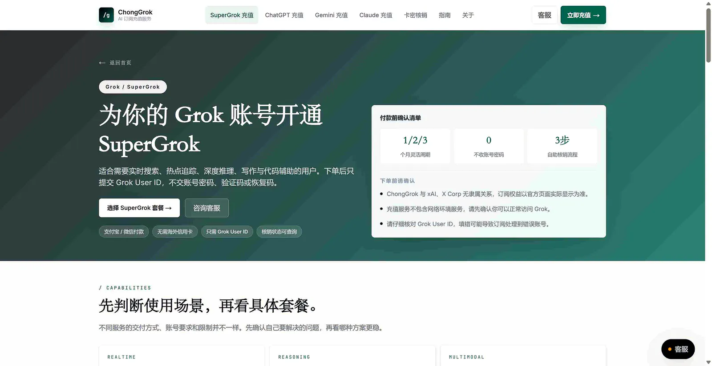

# Grok 订阅知识库：X 联合会员、Grok Bot 与旧版 SuperGrok

这是 **ChongGrok 维护的 Grok 订阅与排障知识库**。新用户先看 [X 联合会员与 Grok Bot](guides/x-subscription-grok-bot-guide.md)；已有旧会员先核对原权益与是否保留，不能把旧版充值当作联合会员转换。

> **English summary:** A ChongGrok-maintained guide to The X Subscription, Grok Bot, legacy SuperGrok renewal and payment troubleshooting. ChongGrok is an independent third-party service, not an authorized reseller of xAI, X or Cursor.

**Keywords:** `SuperGrok China` · `Grok recharge` · `Grok User ID` · `Grok payment failed` · `SuperGrok still Free` · `Grok Build 403` · `Grok 4.5` · `chonggrok.com`

## 先说结论

- 有可用境外支付方式：可以直接尝试官方订阅，并按官方页面完成验证。
- 考虑第三方支付协助：联合会员新购查看 [X 联合会员服务页](https://chonggrok.com/x-subscription)；符合条件的旧版续费查看 [旧版 SuperGrok](https://chonggrok.com/supergrok)，付款前核对账号与交付条件。
- 旧版 SuperGrok 兑换只需卡密与 **User ID**；联合会员的 [verify-x](https://chonggrok.com/verify-x) 要求 **Grok SSO**，这是临时登录凭证，不能当作普通账号标识。
- 账号始终归用户自己；升级完成后，应由用户回到 grok.com 检查订阅状态。
- User ID 虽不是密码，仍属于账号标识，应只在确认无误的核销页面提交。
- 任何线上订阅服务都不是零风险；本文不作“绝对安全”“100% 不封号”等承诺。

ChongGrok **不办理旧会员转联合会员**；需要转换时使用官方 Unify 流程。[官方购买政策](https://x.ai/pricing)明确未授权第三方销售，并说明相关账号可能被暂停或终止。

## 符合条件的旧版 SuperGrok 续费流程

1. 打开 [https://chonggrok.com/supergrok](https://chonggrok.com/supergrok)。
2. 确认账号可登录且符合旧版商品条件，再选择当前展示的 1 个月或 3 个月周期。
3. 使用支付宝或微信付款，保存订单信息和卡密。
4. 打开 [https://chonggrok.com/verify-grok](https://chonggrok.com/verify-grok)，提交卡密并完成验证。
5. 按页面提示提交自己的 Grok User ID，核对账号后确认充值。
6. 等待系统处理，完成后回到 grok.com 验收订阅状态；如未刷新，退出后重新登录再检查。

上图保留旧界面示例，当前表单与商品以实际页面为准。套餐和价格可能调整，本文不固定展示金额，请以下单页实时信息为准。

## Grok User ID 怎么核对

1. 先在 [grok.com](https://grok.com) 登录要升级的账号，并确认没有登录错账号。
2. 购买后进入 [卡密核销页](https://chonggrok.com/verify-grok)，按照页面当前显示的说明核对 Grok User ID。
3. 只提交页面明确要求的账号标识，不要用邮箱、X 用户名、昵称、密码、验证码或恢复码代替。
4. 如果页面显示完整的账号或会话内容，或者你无法判断哪一项是 User ID，应立即停止，不要复制整页内容，并通过 [SuperGrok 服务页](https://chonggrok.com/supergrok)联系售后确认。

xAI 当前消费者 FAQ 说明了账号、账单和支持入口，但没有把某个内部接口公布为长期固定的 User ID 获取方法。因此，本指南以核销页实时说明为准，不把可能变化的内部地址包装成 xAI 官方流程。详细说明见 [Grok User ID 查找与核对指南](guides/grok-user-id.md)。

## 充值方式对比

| 方式 | 适合谁 | 优点 | 需要注意 |
|---|---|---|---|
| 官方页面直接订阅 | 有稳定境外支付方式的用户 | 自己完成支付与续费 | 可能遇到卡片、3DS、账单地址或地区验证问题 |
| 应用商店订阅 | 熟悉对应商店账户的用户 | 对部分用户更方便 | 价格、退款、续费和权益同步以商店为准 |
| ChongGrok 旧版续费 | 账号符合旧版条件且考虑支付宝/微信的用户 | 当前兑换提交 User ID，无需密码 | 不转换联合会员；第三方政策与交付条件需先了解 |

本仓库不推荐多人共享账号或成品号，也不提供 API 额度、接码或批量注册服务。

## 内容集群

| 专题 | 解决的问题 |
|---|---|
| [Grok 联合会员（The X Subscription）怎么选？2026 四档价格、Grok Bot 权限与国内开通指南](guides/x-subscription-overview.md) | 四档价格、Grok Bot 权限与国内开通流程。 |
| [为什么开了 Grok 会员还是用不了 Grok Bot？2026 权限解锁、每周额度池（Weekly Pool）与 Top-ups 指南](guides/grok-bot-weekly-pool-guide.md) | 无权限排查、Weekly Pool 与 Top-ups 使用说明。 |
| [老版 SuperGrok 与 Cursor 要不要合并（Unify）？2026 X 联合会员迁移避坑、苹果退费与旧版保留指南](guides/supergrok-unify-migration-guide.md) | Unify 迁移、苹果退费与旧版订阅保留说明。 |
| [X 联合会员下使用 Cursor 编程怎么计费？2026 Grok 第一方额度池与 Claude / GPT 扣费规则解析](guides/grok-cursor-shared-billing.md) | Grok 第一方额度池与 Claude、GPT 扣费规则。 |
| [X 联合会员与 Grok Bot](guides/x-subscription-grok-bot-guide.md) | 四档、共享周额度、旧版资格与官方转换 |
| [SuperGrok 自助充值完整流程](guides/supergrok-auto-recharge.md) | 从下单、卡密核销、User ID 到到账验收 |
| [Grok User ID 怎么找](guides/grok-user-id.md) | 找到正确的 `userId`，避免提交邮箱或 X 用户名 |
| [联合会员与旧版 SuperGrok 怎么选](guides/supergrok-plans.md) | 先选新旧方案，再按用量和项目周期选择 |
| [Grok 付款失败排查](guides/supergrok-payment-errors.md) | card declined、3DS 与账单地址 |
| [付款成功但仍显示 Free](guides/supergrok-paid-but-still-free.md) | 账号、购买入口、App 同步、周额度与卡密核销 |
| [Grok Build 登录与 403 排查](guides/grok-build-login-403.md) | 浏览器授权、设备码、版本、旧会话与订阅权益 |
| [旧版 SuperGrok、X Premium+ 与 X 联合会员](guides/supergrok-vs-x-premium-plus.md) | 区分旧版权益、账号关联与新联合会员，判断是否使用官方 Unify |
| [Grok 4.5 更新说明](guides/grok-4-5-update.md) | 官方已确认能力、入口与 SuperGrok 可用性边界 |

## 历史版本资料：Grok 4.5

xAI 于 **2026 年 7 月 16 日**发布 Grok 4.5，官方将其定位于编程、智能体任务和知识工作。发布页明确写到首发入口包括 Grok Build、Cursor 和 SpaceXAI console，但没有在该页明确承诺所有普通 grok.com / SuperGrok 账号都能立即在模型选择器看到 Grok 4.5。

因此，开通 SuperGrok 前应检查自己账号内的模型选择器和官方实时说明，不应把“购买 SuperGrok”理解为“保证立即获得 Grok 4.5”。详见 [Grok 4.5 更新与 SuperGrok 可用性说明](guides/grok-4-5-update.md)。

## 安全与业务边界

- 不应提交登录密码、邮箱验证码、短信验证码或恢复码。新旧兑换所需凭据分别核对。
- 旧版流程仅提交 User ID；联合会员 SSO 具有临时登录权限，不在聊天或公开截图发送。
- 保留订单号、卡密与处理记录；旧版订单核对 User ID，联合会员核对目标工作区。对外提供脱敏状态截图，不在聊天发送 SSO。
- 不承诺零风险、绝对安全、永久不封号或固定到账时间。
- 本知识库讨论 Grok 订阅，不提供 API 额度、接码或批量注册流程。
- ChongGrok 与 xAI、X 不存在隶属或官方合作关系。

## 主站深度资料

- [SuperGrok 充值完整教程](https://chonggrok.com/blog/supergrok-chongzhi-zhinan)
- [Grok User ID 怎么找](https://chonggrok.com/blog/grok-user-id-zenme-zhao)
- [SuperGrok 国内充值失败排查](https://chonggrok.com/blog/supergrok-payment-failed-ai-recharge-2026)
- [SuperGrok 安全充值检查清单](https://chonggrok.com/blog/supergrok-safe-recharge-checklist)
- [SuperGrok 套餐怎么选](https://chonggrok.com/blog/supergrok-taocan-zenme-xuan)
- [SuperGrok 与 X Premium+ 对比](https://chonggrok.com/blog/supergrok-vs-x-premium-plus)

## 官方参考

- [The X Subscription 官方总览](https://docs.x.ai/x-subscription/overview)
- [官方定价与购买政策](https://x.ai/pricing)
- [xAI: Grok 4.5](https://x.ai/news/grok-4-5)
- [xAI Consumer FAQ](https://docs.x.ai/grok/faq)
- [Grok plans](https://grok.com/plans)

## 仓库入口

- GitHub Pages：<https://he20000405-pixel.github.io/supergrok-china-guide/>
- English guide：[README_EN.md](README_EN.md)
- 专题索引：[guides/](guides/)
- SuperGrok 充值：<https://chonggrok.com/supergrok>
- 旧版 Grok 卡密兑换：<https://chonggrok.com/verify-grok>
- X 联合会员兑换：<https://chonggrok.com/verify-x>

更新：2026-10-28。历史版本文章保留各自的核查范围与日期。
